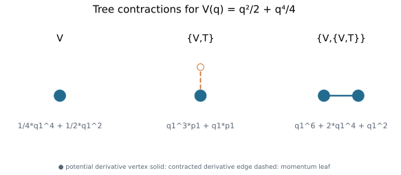
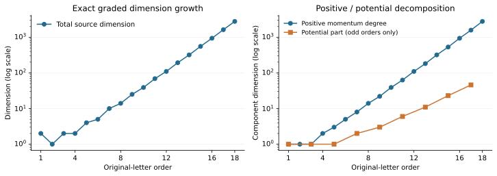
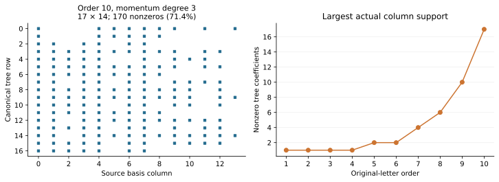

# Mechanical Lie

**Exact symbolic tree and Poisson brackets for Euclidean mechanical Hamiltonians.**

Mechanical Lie helps inspect the commutators that occur in geometric integration
and splitting-method analysis. It represents the universal kinetic energy
`T = |p|²/2` and a position potential `V(q)` by canonical trees, expands nested
brackets with exact rational coefficients, and realizes them as complete sparse
polynomials for a concrete potential. The runtime uses only the Python standard
library.

This is a symbolic research tool. It does not integrate ODEs, compute BCH
compositions, or solve for splitting coefficients.

## Install and try

Python **3.11–3.14**. Install the tagged GitHub version in a virtual environment:

```sh
python3 -m venv .venv
source .venv/bin/activate          # Windows: .venv\Scripts\activate
python -m pip install "git+https://github.com/yuiyuiui/mechanical-lie.git@v0.1.0"
```

The package is distributed through GitHub; this command does not require a PyPI
publication. You can also install the wheel attached to the release.

```python
from mechanical_lie import bracket, kinetic, phase_space, poisson, potential

q, p = phase_space(1)
v = q[0]**2 / 2 + q[0]**4 / 4      # Modify this exact rational potential.
t, b = kinetic(), potential()

expression = bracket(b, bracket(b, t))
result = expression.realize(v)
print(result)                      # q1^6 + 2*q1^4 + q1^2
print(expression.momentum_degrees) # (0,)

from mechanical_lie import Polynomial
direct = poisson(v, poisson(v, Polynomial.kinetic(1)))
assert result == direct            # Full coefficientwise polynomial equality.
```

The convention is `{f,g} = Σ(f_q g_p − f_p g_q)`, so `{V,T} = p·∇V`.
Pass integers and `fractions.Fraction`, not floats. Dimension or exponent
length mismatches raise errors rather than being truncated.

## See the algebra



**Trees become derivatives.** Each filled vertex contributes a derivative of
`V`; a solid edge contracts two derivative indices, and a dashed momentum
leaf contributes a component of `p`. These three expressions and their full
quartic polynomial realizations are computed by the supplied example, including
the gradient-square bracket `{V,{V,T}}`.



**Two parts of the graded algebra.** Original-letter orders 1–18 split into
positive-momentum-degree and degree-zero potential dimensions on logarithmic
scales; the potential part is zero at even orders and is plotted only at odd
orders. The scalar data
come from an earlier exact finite reconstruction, with an immutable source link
and hash in the [case notes](numerical_case/README.md). Full modular column rank
matched those finite dimensions. This plot does not establish an all-order
theorem or injectivity for a fixed potential.



**Actual symbolic sparsity.** The left panel is the nonzero pattern of the
largest formed matrix block in the fresh order-10 case; the right panel reports
the largest number of nonzero tree coefficients in a column at each order.
Rows are canonical mechanical trees and columns are graded source basis elements.
These are algebraic work/storage indicators, not a runtime benchmark.

## What is available

| Operation | Entry point |
| --- | --- |
| Universal kinetic/potential generators and nested brackets | `kinetic`, `potential`, `bracket`, `Hamiltonian` |
| Full rational polynomial realization and direct differentiation | `Hamiltonian.realize`, `Polynomial`, `phase_space`, `poisson` |
| Commutative, nonassociative gradient products and binary trees | `commutative_product`, `binary_trees`, `potential_tree` |
| Associative Lie words, PBW degree lowering, marker projection/retraction | `mechanical_lie.algebra` |
| Integer sparse modular rank and finite matrix/certificate checks | `modular_rank`, `mechanical_lie.validation` |

See [the API](docs/api.md) for types, exact conventions and examples, and
[the methods and limits](docs/methods.md) for what the checks do and do not imply.
The [quartic example](examples/quartic.py) can be edited and run directly after
installation. The public API is small and provisional at version 0.1.0;
`_engine` is an internal implementation detail.

## Reproduce the figures

From a checkout of this repository:

```sh
python -m pip install -e ".[figures]"
python numerical_case/compute_cases.py --output numerical_case/results/demo
python numerical_case/plot_cases.py --data numerical_case/results/demo --output numerical_case/figures
```

Use a fresh results directory. The computation reconstructs only through order
10 and checks complete polynomials through order 6; it does not repeat the
historical order-18 run. Fixed potentials, exact outputs, source hashes and
actual checked/skipped stages are recorded. The plotting command also reads
the included compact historical dimension table. Both SVG and PDF figures are
generated; large integer matrices and caches remain local and ignored.

## Develop and validate

```sh
python -m pip install -e ".[dev]"
python -m unittest discover -s tests -v
python -O -m unittest discover -s tests -v
python -m ruff check .
python -m ruff format --check .
python -m build
python examples/quartic.py
```

CI builds the wheel, installs it before running tests, compares full polynomial
coefficients against independent SymPy differentiation, and exercises the
worked example. A separate job regenerates the numerical summaries and figures.
Development extras are pinned; the core package has no third-party runtime
dependencies. See [contributing](CONTRIBUTING.md) for the fresh-install checks.

## Credit, citation and scope

Software author: **Kaiwen Jin**, `yui.ui.siki@gmail.com`. License:
[BSD 3-Clause](LICENSE). Use [CITATION.cff](CITATION.cff) to cite this release.
The [credit and references](docs/credits.md) identify the mathematical sources
and the earlier public research package from which the integer algorithms were
developed.

OpenAI ChatGPT assisted with initial research/code development; OpenAI Codex
assisted with API design, implementation, documentation and tests. AI assistance,
test results and an open submission are not independent human review or formal
proof certification. The associated [mathematical manuscript](https://github.com/yuiyuiui/AIM/blob/8dc12e3f97d7c2230981ad0d46ab00aa06188bfd/research/solutions/519-euclidean-mechanical-lie-algebra/paper/main.pdf)
and [submission](https://github.com/MColbrook/AIM/pull/40) are separate from the
software's finite validation claims.
